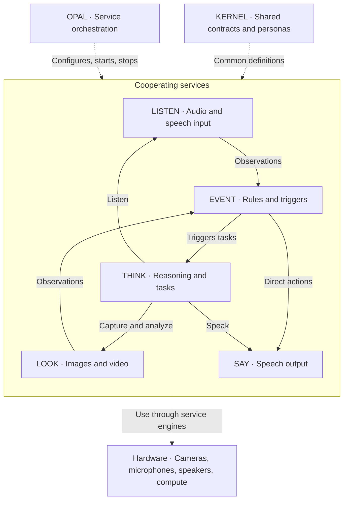
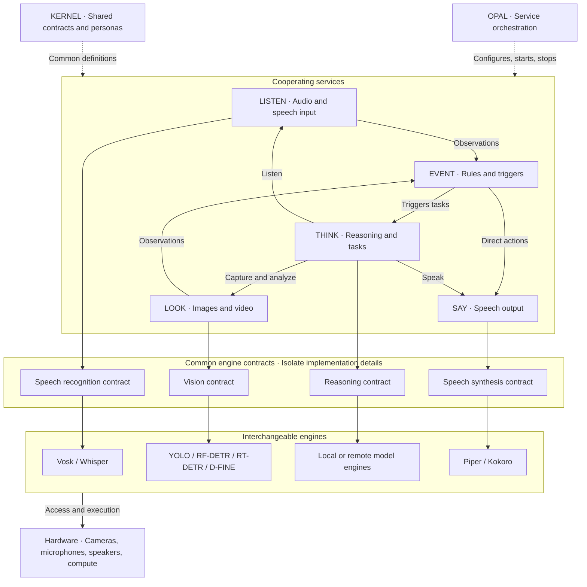
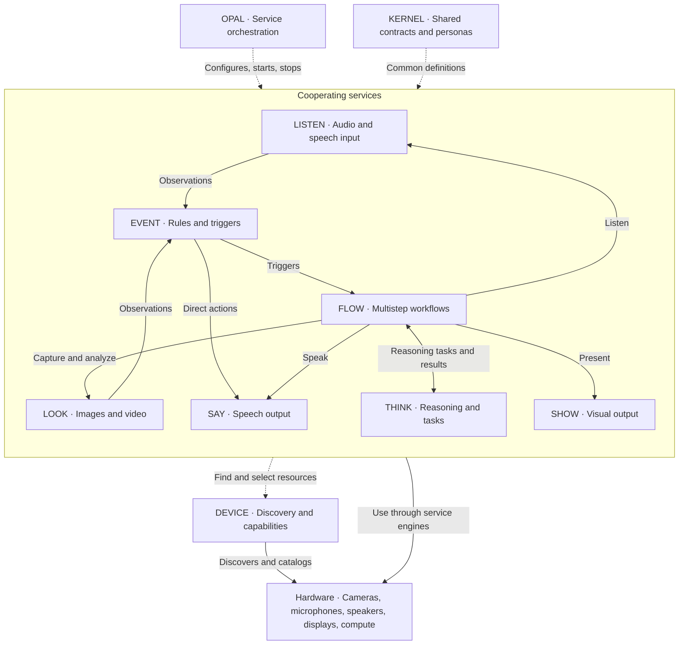

OPAL is a modular Python framework that connects AI’s ability to see, hear, reason, speak, and act. Its components work together: **LOOK** interprets images and video, **LISTEN** processes audio, **THINK** coordinates reasoning and tasks, **SAY** provides speech, and **SHOW** handles visual output. **EVENT** connects observations to actions, **DEVICE** discovers available hardware, and the **OPAL orchestrator** brings the services together—on one computer or across a network.

OPAL is being built to move computing beyond screens, keyboards, and isolated apps. Rather than making people navigate interfaces, it aims to make intelligence available wherever life happens: aware of its surroundings, accessible through natural conversation, and able to respond through nearby devices. It’s a foundation for ubiquitous computing, built around local AI, interchangeable components, and your control over your data and how the system behaves.

With OPAL, you could build a tutor that sees a homework problem and talks it through, a workshop assistant that watches your project and offers guidance, or a photo librarian that finds familiar faces and forgotten moments. You could connect rooms with voice interaction, respond to household events, or give a robot perception and personality. Start with one useful ability, then combine components to create an environment that can understand and help.

## Design Principles

The following working principles ground me in my strategic objectives with OPAL.  I consult them when making major decisions and it really helps keep me working on the practical rather than the new and shiny.

|Tenet|What it means|
|---|---|
|**Move beyond traditional interfaces**|Make intelligence accessible through sight, sound, conversation, and the environment around us.|
|**Standalone first, connected when useful**|Each service should provide value independently; integration adds capabilities without becoming mandatory.|
|**Compose focused capabilities**|Keep vision, listening, speech, reasoning, display, events, and device discovery distinct and combine them as needed.|
|**Keep deployment flexible**|Support embedded Python, local transports, and network services without changing the meaning of operations.|
|**Local first, user controlled**|Favor local intelligence and explicit control over data, devices, models, and behavior.|
|**Federate without requiring a central server**|Allow independent hosts to discover and share resources while retaining local ownership.|
|**Separate capability from implementation**|Engines perform the work; plugins integrate implementations. Common contracts let implementations vary.|
|**Discover capabilities rather than assume them**|Describe what devices, engines, models, and runtimes actually support.|
|**Keep contracts consistent**|Use common identifiers, errors, event conventions, and configuration patterns across services.|
|**Make interfaces equivalent**|Expose corresponding capabilities through APIs, CLI commands, and graphical interfaces.|
|**Keep ownership clear**|Services own runtime configuration; engines own model storage, execution limits, and queues; registries describe resources.|
|**Make automation explicit**|Keep discovery and event publishing opt-in, and make routing, retries, and fallback behavior configurable.|
|**Bound work and failure**|Use bounded queues, deadlines, loop protection, and explicit overload handling; avoid indefinite waits and silent failures.|
|**Separate visibility from permission**|Discovering a device or seeing its metadata does not grant permission to operate it.|
|**Preserve traceability and reproducibility**|Carry request and causation identifiers, preserve frame identity, and record execution settings and meaningful metrics.|
|**Add complexity only when justified**|Start with the simplest useful design and introduce federation, pipelines, and orchestration without burdening basic use.|

## Modules

### Existing

|Module|Purpose|
|---|---|
|**OPAL**|Orchestrates the system—configures, starts, and stops services.|
|**LOOK**|Acquires and interprets images and video through interchangeable vision engines.|
|**LISTEN**|Processes audio and recognizes speech for commands and conversation.|
|**THINK**|Uses AI models to reason, manage tasks, and coordinate capabilities.|
|**SAY**|Converts text into speech using selectable voices and speech engines.|
|**EVENT**|Routes events and applies rules that turn observations into actions.|

## Planned

|Module|Purpose|
|---|---|
|**SHOW**|Provides visual presentation and media playback.  Also planning to include a GUI construction language OPAL-THINK can use to interact effectively with users.|
|**FLOW**|Defines and runs workflows that connect OPAL capabilities into multistep processes, coordinating sequence, branching, and data passed between steps.|
|**DEVICE**|Discovers and catalogs microphones, speakers, cameras, and compute resources across hosts.|

## Diagram

## Engines Included

### Planned

